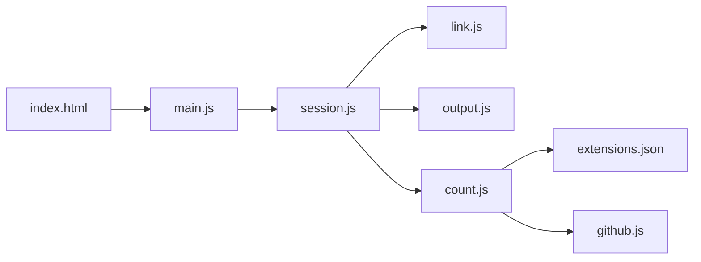

# Repo KLOC Counter: maintainer's guide

1. [Update the list of code extensions](#update-the-list-of-code-extensions)
2. [How the code works](#how-the-code-works)
   - [Files and folders](#files-and-folders)
   - [Diagram](#diagram)
   - [How a count works](#how-a-count-works)
   - [Trying the page on your computer](#trying-the-page-on-your-computer)
   - [Tests](#tests)
   - [Rules for changing the code](#rules-for-changing-the-code)

## Update the list of code extensions

A file is counted when its extension is in `src/extensions.json`. That list is made from the programming languages in
GitHub Linguist's
[`languages.yml`](https://github.com/github-linguist/linguist/blob/main/lib/linguist/languages.yml), minus the
extensions in `.github/scripts/excluded-extensions.json`. Linguist adds languages now and then; update the list a few
times a year, or when someone reports a language that is not counted.

You need Node.js 22 or newer and an internet connection. Run the commands from the project's folder.

1. **Run the updater.** `npm run update-extensions`. It prints, for example,
   `976 extensions written to src/extensions.json, 6 excluded`. If it prints `... answered 404`, Linguist has moved
   the file: find its new address and change `SOURCE` in `.github/scripts/update-extensions.js`.
2. **Exclude an extension, if one is wrongly counted.** Some extensions belong both to a programming language and to
   something else, such as `.md`, which is Markdown but also "GCC Machine Description". Add the extension, in lower
   case and with its dot, to `.github/scripts/excluded-extensions.json`, then run step 1 again. To count it again,
   take it out and run step 1.
3. **Check.** `npm ci`, then `npm test`: every test must pass.
4. **Look at the change.** `git diff src/extensions.json` shows the extensions added and removed.
5. **Commit** `src/extensions.json`, and `excluded-extensions.json` if you changed it.

## How the code works

Repo KLOC Counter is one web page, `index.html`, with no server of its own. GitHub Pages serves the files as they are;
there is no build step. The page loads `src/main.js`, which draws a terminal. Everything the terminal does is in plain
functions in `src/`, which the tests call directly with a fake GitHub, so they need no browser and no network.

### Files and folders

| File or folder | What it holds |
| --- | --- |
| `documentation/` | This guide, `RULES.md`, `REQUIREMENTS.md`, `TESTS.md`, `DECISIONS.md`, `TERMINOLOGY.md`, and the development log in `DEVLOG/`. |
| `README.md` | Introduces the project. |
| `LICENSE` | The terms under which anyone may use the project. |
| `AGENTS.md` | What an AI agent must know before it changes anything here: what to read first, what it must never do, and when a change is done. |
| `CLAUDE.md` | The same for Claude Code, which reads this file by itself. It loads `AGENTS.md` and `RULES.md`. |
| `.claude/skills/` | Step-by-step procedures for AI agents, one folder each, such as how to write the development log. `ub-mode` is copied from another project and keeps its licence beside it. |
| `.claude/settings.json` | Stops Claude Code from committing and from changing `REQUIREMENTS.md`. |
| `.github/` | What GitHub shows contributors: how to contribute, report a bug or a security hole, the pull request form, and the accessibility checklist. |
| `.github/workflows/checks.yml` | Tells GitHub to run the checks and the tests on every push and pull request. |
| `.github/scripts/check-rules.sh` | Checks the rules a script can check; see [Tests](#tests). |
| `.github/scripts/update-extensions.js` | Makes `src/extensions.json`; see [the first chapter](#update-the-list-of-code-extensions). |
| `.github/scripts/excluded-extensions.json` | Extensions never counted, though Linguist calls them programming. |
| `.gitattributes`, `.gitignore` | How Git treats line endings, and which files it leaves out. |
| `index.html` | The page: the terminal's layout and colours. GitHub Pages serves it. |
| `package.json`, `package-lock.json` | Tell npm how to run the tests. There are no dependencies; install with `npm ci`, never `npm install` (Rule 27). |
| `src/main.js` | Draws the terminal in the page and passes the keys Enter, up and down to the session. |
| `src/session.js` | The terminal itself: what was shown, the history of input, the commands, and a count with its progress line. |
| `src/link.js` | Turns what the user typed into an owner and a repository, or into "not a valid link". |
| `src/github.js` | Asks GitHub for the list of files, and reads a file, trying twice. |
| `src/count.js` | Picks the code files and counts their lines that are not blank. |
| `src/output.js` | Every text the terminal shows: help, errors, the progress line and the result. |
| `src/extensions.json` | The extensions of code files, made by `update-extensions.js`. Do not edit it by hand. |
| `tests/` | The tests, and `fake-github.js`, a stand-in for GitHub that the tests use. |

### Diagram



### How a count works

1. The user types `github.com/tj/commander.js/tree/master` and presses Enter. `parseLink` in `link.js` turns it into
   `{ owner: 'tj', repo: 'commander.js' }`, or `null`, which shows `error: not a valid link`.
2. `listFiles` in `github.js` asks GitHub's API once for every file of the default branch, called `HEAD`:
   `https://api.github.com/repos/tj/commander.js/git/trees/HEAD?recursive=1`. That is the only call that counts
   against GitHub's limit of 60 calls an hour without a token. A 404 means private or missing; a missing quota,
   header `x-ratelimit-remaining: 0`, means the limit is reached; a 409 means an empty repository.
3. `isCodeFile` in `count.js` keeps the paths whose extension, such as `.js` or `.coffee.md`, is in `extensions.json`.
4. `readFile` fetches each kept file from `raw.githubusercontent.com`, which does not count against the limit, eight
   at a time. A file that fails twice is left out, and the result warns that the count is partial.
5. `countLines` counts the lines with at least one character that is not whitespace. `resultLines` in `output.js`
   shows them as `18.4 KLOC · 171 files · 18385 lines`.

While this runs, `session.js` shows the progress line and turns its first character every 300 ms (`FRAME_MS`).

### Trying the page on your computer

The page loads its scripts as modules, which browsers refuse to do from a file opened directly. Serve the folder
instead, for example with Python: `python -m http.server 8000` in the project's folder, then open
`http://localhost:8000`. Any other static web server works too.

### Tests

Run the tests with `npm ci`, then `npm test`. GitHub runs them on every push and pull request; a green tick in the
repository's **Actions** tab means they all passed.

`tests/counting.test.js` tests what is counted, `tests/links.test.js` which links are accepted, and
`tests/terminal.test.js` what the terminal shows. They call the code in `src/` with `fakeGitHub` from
`tests/fake-github.js`, never the real GitHub. `src/main.js` and `index.html` are only drawing, and are checked by
hand: open the page, type `help`, a link, and use the arrows.

`tests/verify-rules.test.js` checks two rules in every code file: no comments (Rule 10) and no function over 60 lines
of code (Rule 11). A file is code when its name matches `code_pattern` in `check-rules.sh`, so a new kind of code file
is added there once. If Test 37 or 38 fails, it names the file and the line; move the comment's text into this guide,
or split the function. Node runs the test files in the order of their names, which is why this one, run last, starts
with `verify`.

GitHub also runs `.github/scripts/check-rules.sh`, which checks what a script can check without knowing the language of
the code: that no folder holds too many files, that no two files share a name, that no line or file of code is too long,
that the development log keeps its form, and that `TESTS.md` numbers its tests 1, 2, 3 and so on. Run it yourself before
you commit, from the project's folder:

```
bash .github/scripts/check-rules.sh
```

On Windows, run it in Git Bash. Each line says `ok`, `skip`, `todo` or `FAIL`, and every `FAIL` names the file and the
rule. A `todo` does not fail: it lists the placeholders, names in double braces, still to fill in from the template.

When you add, change or remove a test, update `TESTS.md`.

Most of accessibility cannot be tested. `.github/ACCESSIBILITY.md` lists every success criterion of WCAG 2.2 AA; those
marked **human verification required** you check yourself, by using the interface as the item says, whenever a change
touches what the item is about. Mark each `[x]` when it holds.

AI agents write code by `ub-mode`, which runs three tools that are not part of the project: crapper, which scores
each function by how complex it is and how much of it the tests run; dryer, which finds code written twice; and
mutator, which changes the code on purpose to see whether a test notices. They need Python 3.11 or newer; for C also
gcc, CMake and gcovr (`pip install gcovr`), and on Windows Ninja. To have them, clone them once next to the project's
folder, in Git Bash:

```
cd ..
git clone https://github.com/cnordenb/crapper
git clone https://github.com/cnordenb/dryer
git clone https://github.com/cnordenb/mutator
```

The first run of each sets itself up. What they write in the project, `.metrics/` and `target/`, Git leaves out.
`AGENTS.md` lists the languages they work for.

### Rules for changing the code

`RULES.md` has the full list; the tests and `check-rules.sh` check most of it.

- No file over 400 lines of code, no function over 60, and no line over 120 characters.
- No folder over 7 files, except `documentation/DEVLOG/`; the main folder may hold 8. Standard files, such as
  `README.md` or `package.json`, are not counted; `standard_files` in `check-rules.sh` lists them.
- No two files with the same name, except `SKILL.md`.
- No comments in the code. Explain what needs explaining in this guide instead.
- Never `npm install`; only `npm ci` (Rule 27). The project has no dependencies, and keeps it that way.
- `REQUIREMENTS.md` defines what the project does, and only the chief developer may change it.
- Record what you change, and why, in the last part of `documentation/DEVLOG/`, under the day's date, and list any
  decision in `DECISIONS.md`.
- Only humans commit. AI agents leave their work for a human to read, test and commit.
